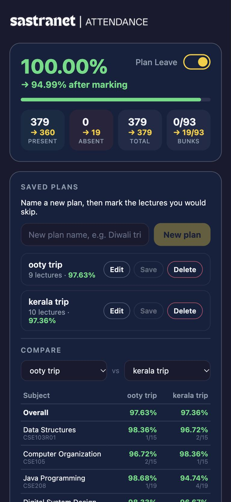

# Leave Planner

A "what if I skip this?" planner for sastranet, SASTRA's attendance app.

Sastranet only tells you your attendance so far. Before taking leave I always had to work out by hand
how many classes I could still miss in each subject without going under 75%. So I built a prototype
of a feature that does it for you: mark the lectures you plan to skip and it shows what your
attendance would be at the end of the semester, subject by subject.

Live demo: https://varunjishgod.github.io/leave-planner/ (made for a phone screen)

<p>
  
  &nbsp;
  
</p>

## What it does

- Looks like the sastranet attendance screen (same header, cards, stat chips and numbered period bubbles)
- Turn on **Plan Leave** and every lecture starts as present (100%). Tap a lecture to mark it
  absent, or tap a date to mark the whole day
- Shows current → projected % for overall attendance and for every subject
- Green at 80% and above, yellow between 75 and 80, red below 75
- BUNKS used/allowed per subject
- Save plans with a name (e.g. "Kerala trip") and edit, save or delete them later
- Compare two plans, or combine a few of them to see if you'd end up with a shortage
- With Plan Leave off the screen is just view only

The timetable and calendar are the real ones for my class (3-BCSE_NW-K, odd semester 2026-27):
82 working days, CIA days count as working days but have no classes, and some Saturdays follow
another day's timetable.

## How the numbers are calculated

All of it is in `src/logic/attendance.js`, as plain functions with no React in them.

- attendance % = present / total × 100
- projected %: anything you haven't marked counts as present, anything you marked counts as absent
- allowed bunks = floor(total lectures in the semester × (100 − 75) / 100)

For example Digital System Design has 60 lectures, so you get 15 bunks. Miss 16 and you're at
44/60 = 73.33%.

The 75% limit is set in `src/config.js`, it's not hardcoded anywhere else.

## A few decisions

- The planner never changes the actual attendance data. It only keeps a list of marked lectures
  (like `"2026-09-22#3"`) and builds a copy of the days with those marked absent.
- In the real app the attendance would come from SWI, which is read only. Saved plans are just
  stored in localStorage on your own phone.
- Percentages, bunks and colours aren't stored in state. They're recalculated from the marked
  lectures on every render so they can't go out of sync.

## Tech

React + Vite, plain JavaScript and plain CSS (no UI library). Only `useState` and `useEffect`.

```
src/
  App.jsx          state and layout
  config.js        threshold (75), safe level (80), today's date
  data/            courses, weekly timetable, academic calendar
  logic/           attendance maths, schedule, saved plans, date helpers
  components/      SummaryCard, SubjectCard, DayList, PeriodBubble, ScenarioPanel, ...
```

## Running it

```bash
npm install
npm run dev
```

`npm run deploy` builds it and pushes it to GitHub Pages.

## Notes

- "Today" is fixed to 21 Sep 2026 in `config.js` so the demo always looks the same.
- Minor slots in the timetable aren't tracked.
- The header image and screenshots in `docs/` are from the sastranet app. I only used them to match
  the design for this prototype.
