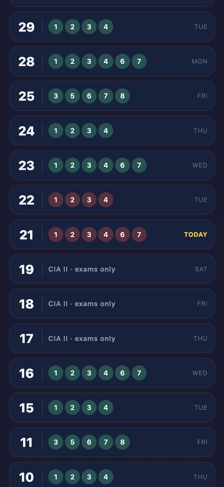

# Leave Planner: attendance what-if simulator for sastranet

A feature prototype for **sastranet**, SASTRA's student attendance app.
Sastranet shows your attendance. **Leave Planner helps you plan it**: mark the lectures
you might skip and instantly see how every subject's attendance and bunk budget change.
You can also save plans, compare them, and combine them to check for an attendance shortage.

**Live demo:** https://varunjishgod.github.io/leave-planner/ (best on a phone, or in your browser's phone view)

<p>
  
  &nbsp;
  
</p>

## Features

- **Matches sastranet's attendance screen.** The same header, summary card, stat chips,
  Coursewise / Day wise tabs and numbered period bubbles (green = present, red = absent).
- **Plan Leave mode.** Every lecture starts green (100%). Tap a lecture, or a date for the
  whole day, to mark it absent. Every value is shown as **current → projected**.
- **Colour bands.** Green at 80% and above, yellow from 75% to under 80%, red below 75%,
  for the overall % and for each subject.
- **Per-subject bunk budget.** `BUNKS used/allowed`, where allowed = the most absences that
  keep the subject at 75% or above by the end of the semester.
- **Real academic calendar.** 82 working days, CIA exam days (working days with no classes),
  holidays, and working Saturdays that follow a given weekday's timetable.
- **Saved plans.** Create a plan (e.g. "Kerala trip"), then **Edit**, **Save** or **Delete** it.
  Unsaved changes are flagged.
- **Compare two plans** side by side, subject by subject.
- **Combine plans.** Pick several plans to see the total effect: lectures missed (shared
  lectures counted once), each subject's %, and a red **attendance shortage** box listing
  every subject that would fall below 75%. All picked plans show red in the day list together.
- **View-only mode.** With Plan Leave off, everything is grey and 0%: nothing is editable.

## How the numbers work

All attendance maths is in [`src/logic/attendance.js`](src/logic/attendance.js) as small
pure functions (no React), so it is easy to test and explain.

| Value | Formula |
|---|---|
| Attendance % | `present ÷ total × 100` |
| Projected % | every lecture you did **not** mark counts as present, every marked lecture as absent |
| Allowed bunks | `floor(lecturesInSemester × (100 − threshold) ÷ 100)`, e.g. 60 × 25% = **15** |
| Shortage | projected % below the threshold (75%) |

Example: Digital System Design has 60 lectures, so 15 bunks are allowed.
The 16th absence gives 44 ÷ 60 = **73.33%**, which is a shortage.

## Design decisions

- **The real data is never changed.** The planner only stores a list of marked lectures
  (keys like `"2026-09-22#3"`). `applyPlan()` returns a *copy* of the days with those
  lectures marked, and every number is derived from that copy.
- **Read-only towards SWI.** In the real app, attendance would come from SWI (read-only).
  Saved plans live only in the browser's `localStorage`, on the student's own phone.
- **Limits are config values, never hardcoded.** `THRESHOLD = 75` and `SAFE_LEVEL = 80`
  in [`src/config.js`](src/config.js).
- **Derived values instead of extra state.** Only a few things are state (Plan Leave on/off,
  marked lectures, saved plans, the open plan, combined picks). Percentages, bunks, colours
  and "unsaved changes" are worked out on every render, so they can never go out of date.

## Tech stack

React 19 + Vite, plain JavaScript, functional components and hooks (`useState`, `useEffect`),
plain CSS (no UI libraries), mobile-first (designed for a 390px wide phone).

## Project structure

```
src/
  App.jsx                 state, handlers and layout
  config.js               THRESHOLD, SAFE_LEVEL, TODAY
  data/
    courses.json          the class's 5 theory courses and 2 labs
    timetable.json        weekly timetable (period numbers keep gaps for lunch/free periods)
    calendar.json         semester dates, holidays, working Saturdays, CIA days
  logic/                  pure functions, no React
    attendance.js         counting, %, bunks, colour bands, plans
    schedule.js           builds the 82 working days from timetable + calendar
    scenarios.js          saved plans: storage, save/delete, combine
    dates.js              date helpers (UTC, so time zones never shift a date)
  components/             SummaryCard, SubjectCard, DayList, DayRow, PeriodBubble,
                          ViewTabs, ScenarioPanel, ScenarioCompare, ScenarioCombine, ...
docs/                     sastranet reference screenshots and README screenshots
```

## Run it locally

You need [Node.js](https://nodejs.org/) installed.

```bash
npm install
npm run dev
```

Then open the address it prints (usually http://localhost:5173), ideally in your browser's
phone view at 390px width.

Other commands: `npm run build` (production build), `npm run lint` (Oxlint) and
`npm run deploy` (builds the site and publishes it to GitHub Pages).

## Notes

- This is a prototype. The timetable and calendar are for one class (3-BCSE_NW-K) in the
  odd semester 2026–27. "Today" is fixed to 21 Sep 2026 in `config.js` so the demo is stable.
- "Minor" timetable slots are not tracked.
- The header image and the reference screenshots in `docs/` are from the sastranet app and
  are used only to match its design for this feature pitch.
